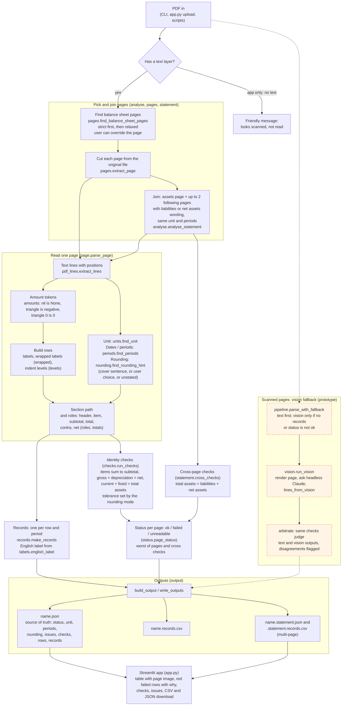

# Balance sheet parser (Ur AI take-home)

Turns one page of a financial statement (PDF with a text layer) into a table of records with section paths, roles, values and accounting checks. Built English first, then Japanese (千円, △, －, repeated labels, （純額）).

## Architecture

Full notes and legend: [docs/architecture.md](docs/architecture.md). Dashed orange = designed and tested, not wired into the CLI or the app (the vision fallback).



The evaluation side (gold, baseline, reviewer session, report) is the second diagram in [docs/architecture.md](docs/architecture.md).

## Run

```
pip install -r requirements.txt
.venv/bin/python -m pytest -q --tb=short

# one page (the best balance sheet page is found unless --page is given)
PYTHONPATH=src .venv/bin/python -m bsparser data/balance_sheet_after_correction.pdf outputs/
# the whole statement: assets page plus the following pages, with cross-page checks
PYTHONPATH=src .venv/bin/python -m bsparser data/heldout/tanshin202603.pdf outputs/ --statement
# --rounding auto|round|cut|unstated (default auto: read from the cover sentence, else unstated); --page N

# accuracy against the gold values, and the held-out run
PYTHONPATH=src .venv/bin/python -m bsparser.accuracy data/balance_sheet_after_correction.pdf \
  data/gold/balance_sheet_after_correction.template.md "Japanese page" outputs/accuracy_japanese.md
.venv/bin/python scripts/run_heldout.py outputs/heldout_after

# try it in a browser: drop in a PDF. Only real balance sheet pages are offered, assets and liabilities pages are read
# together, the page image sits beside each table, rows of a failed check are red with a why, and CSV/JSON download
.venv/bin/streamlit run app.py
```

Output per PDF: `<name>.json` (source of truth: status, unit, periods, rounding and its source, issues, checks, rows, records) and `<name>.records.csv` (view of the records). With `--statement`: `<name>.statement.json` (pages, cross-page checks, status) and `<name>.statement.records.csv`.

## Where things are

- `docs/report.md`: what "correct" means, results, baseline comparison, limits, scanned-page design. Start here.
- `docs/decisions.md`: every agreed decision (D1 to D23).
- `src/bsparser/`: `amounts` (tokens), `pdf_lines`, `levels`, `roles`, `page`, `checks`, `totals`, `statement` (cross-page checks), `rounding` (cover hint), `pages` (page finder), `analyse`, `status`, `records`, `output`, `gold`, `baseline`, `report`, `accuracy`, and the vision fallback (`vision`, `arbitrate`, `pipeline`, `vision_eval`). `app.py` is the Streamlit page; `scripts/` has the held-out runners.
- `data/`: the real page, English fixtures (clean and messy, with generator in `tests/make_english_fixture.py`), four development filings in `heldout/`, three fresh filings in `fresh/`, gold template, label dictionary.
- `outputs/`: committed results for the real page, the English fixtures, the saved vision replies and their judged outputs, and the held-out runs before (`heldout_before/`) and after (`heldout_after/`) the fixes, and the fresh-filing runs (`fresh_run/` as first run, `fresh_after/` after the fixes).
- `docs/label-check.md`, `docs/translation-check.md`: reviewer-session checks. `docs/ai-log/`: AI session logs.

## Headline and caveats

On the real page: 74 of 74 gold cells exact (first-match baseline: 60 of 74, all misses on repeated labels), 20 of 20 identity checks pass. The page is in-sample, the gold was read by a Claude chat that had seen the page text before, and nobody who reads Japanese checked the labels. The vision fallback (headless Claude, prototype) matched the same 74 cells in 3 of 3 real runs, with 0 cells differing from the text layer, on this clean page only. Four held-out filings exposed gaps that were fixed test first, so they are development data now. Three fresh filings were run once with no fixes: 1 of 3 worked (a Japanese filing), the two English ones did not. After fixing what that showed, all 3 pass end to end, which says the fixes work on those files and nothing about the next ones. The code is frozen; anything found from here is listed as a known limit. See `docs/report.md`.
