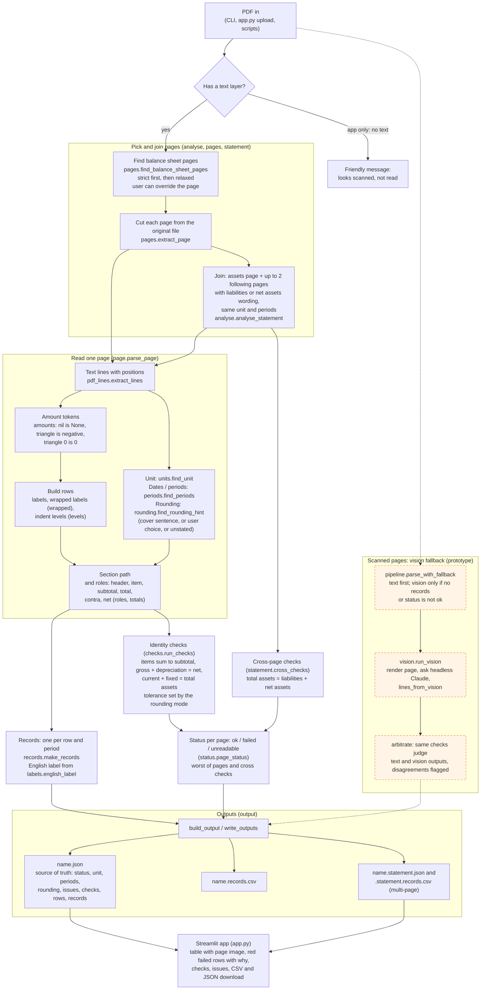
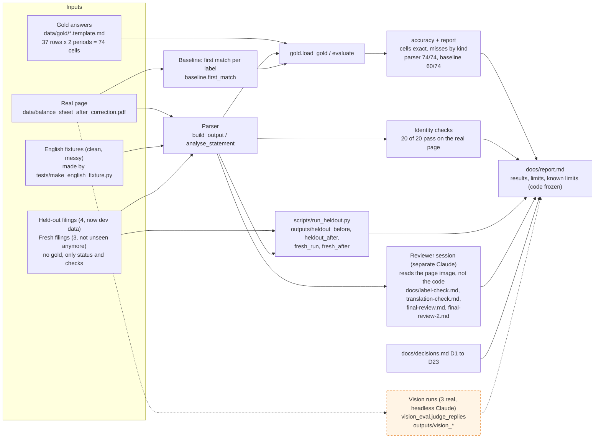

# Architecture

Two diagrams: what runs when you parse a PDF, and how the result is judged. Module names are the files in `src/bsparser/`. Solid boxes are wired in and run. **Dashed orange boxes are designed and tested but not wired into the command line or the app** (see the legend).

## 1. Parsing flow

### Legend and what is not wired in

- **Solid boxes** are called by `python -m bsparser`, `scripts/run_heldout.py` and `app.py` (through `analyse` or `analyse_statement`).
- **Dashed orange boxes** are not on that path:
  - **Vision fallback** (`vision`, `arbitrate`, `pipeline`). Tested, and run for real three times on the original page (`outputs/vision_*`), but nothing in the CLI, the scripts or the app calls `pipeline.parse_with_fallback`. A scanned PDF therefore stops at the app's "looks scanned" message (the app is the only entry point that checks for a text layer), or yields no records on the command line. Prototype only.
- Statement mode (page joining and cross-page checks) is on by default in the app and behind `--statement` on the command line. Without it, one page is parsed on its own.
- Not read at all: equity statements (reported `unreadable`), merged cells, eras other than Reiwa.

## 2. Evaluation side

This side does not run when you parse a file. It judges the parser's output after the fact.

### What each piece is worth

- **Gold** was read by a separate Claude chat that had seen the page text before, so it is not independent. Nobody who reads Japanese checked the labels.
- **Baseline** is the naive first match by label. It loses 14 cells, all on repeated labels, which is why the parser keeps the section path.
- **Identity checks** run inside the parser and need no gold, so they are the only signal on files without gold.
- **Reviewer session** compared the final records with the page image cell by cell, twice: 74 of 74 match. Its one role difference (r12 貸倒引当金) is unexplained and contradicted by the gold template, see the report.
- **Held-out and fresh filings** have no gold. They show status and checks only. The held-out four are development data after their fixes, the fresh three too after the fixes that followed.
